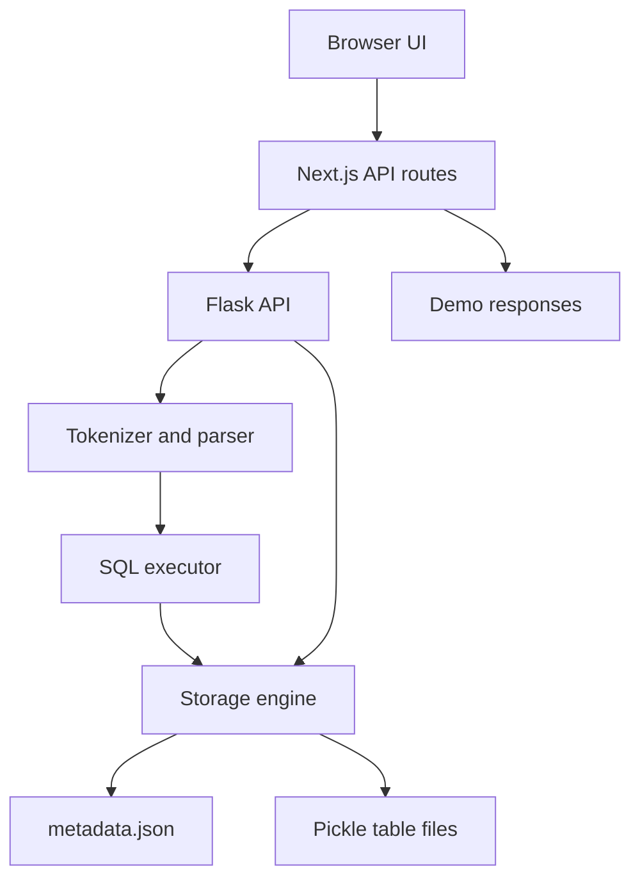

# Database Engine

A learning-focused Python database engine with a Flask API and a Next.js/TypeScript administration UI. This README documents the submitted implementation, including verified limitations.

> Status: educational local prototype. Core create/insert/select/index creation and reload were checked in isolation. The frontend build, browser flow and Flask HTTP integration were not run for this review.

## Contents

- [Project overview and objectives](#project-overview-and-objectives)
- [Feature scope and implementation status](#feature-scope-and-implementation-status)
- [Technology stack and project structure](#technology-stack-and-project-structure)
- [Architecture and request lifecycle](#architecture-and-request-lifecycle)
- [Storage engine and persistence](#storage-engine-and-persistence)
- [SQL tokenizer, parser and executor](#sql-tokenizer-parser-and-executor)
- [REST API reference](#rest-api-reference)
- [Frontend modules and demo mode](#frontend-modules-and-demo-mode)
- [Installation and local execution](#installation-and-local-execution)
- [Demonstration guide and expected results](#demonstration-guide-and-expected-results)
- [Verification results and evidence](#verification-results-and-evidence)
- [Limitations, security and reliability](#limitations-security-and-reliability)
- [Troubleshooting and maintenance](#troubleshooting-and-maintenance)
- [Improvement roadmap and conclusion](#improvement-roadmap-and-conclusion)
- [Module contracts and important functions](#module-contracts-and-important-functions)
- [Reproducible core smoke test](#reproducible-core-smoke-test)
- [HTTP examples](#http-examples)
- [Included source code and report](#included-source-code-and-report)
- [License](#license)


## Project overview and objectives

This project is an educational database engine with a Python backend and a browser-based administration interface. It implements its own table and record storage rather than using SQLite, MySQL, or PostgreSQL. The submitted archive combines that engine with a small SQL implementation, a Flask REST API, and a Next.js application.

### Problem statement

Database users normally see SQL results without seeing how a database stores records, validates columns, or executes a query. This project makes those operations visible through a compact implementation and an interactive interface. Its value is in demonstrating the internal workflow and the boundary between a user interface, an API, and a storage layer.

### Objectives

- Represent schemas using typed Column objects and store rows in logical pages.
- Translate a supported subset of SQL into statement objects and engine operations.
- Persist schemas and table contents between application runs.
- Expose table creation, insertion, querying, indexing, and statistics through HTTP endpoints.
- Provide a graphical SQL editor, table manager, data viewer, and connection diagnostics.

### Scope and intended audience

The system is suitable for a local academic demonstration and source-code study. It is not a production database or a complete SQL implementation. Transactions, query planning, enforced primary-key uniqueness, concurrency control, and authenticated access are absent. All descriptions in this report refer to the submitted source, not to features implied by interface labels.

| Evidence | Basis |
| --- | --- |
| Input archive | database-engine(3).zip |
| Review date | 16 October 2026 |
| Verification | Source inspection and isolated Python core checks |
| Unverified layers | Browser rendering, frontend build and HTTP integration |
| Author details | No student name, institution or guide assumed |


## Feature scope and implementation status

The archive contains both implemented engine behavior and a separate demonstration simulation. This distinction matters when presenting the project or assessing correctness.

| Capability | Actual implementation |
| --- | --- |
| Table creation | Python API, SQL CREATE TABLE, and table-manager interface. |
| Record insertion | Python API and SQL INSERT; one VALUES tuple per statement. |
| Querying | SELECT all or named columns, with one simple WHERE predicate. |
| Table deletion | REST DELETE and table-manager action; SQL DROP is broken. |
| Indexes | Dictionary mapping indexed values to one record; not a B-tree. |
| Persistence | JSON metadata and pickle-serialized table objects. |
| Statistics | Counts of tables, rows, logical pages and indexes. |
| SQL editor | CodeMirror syntax highlighting, suggestions and in-memory history. |
| CSV export | Exports the currently loaded page, with escaping limitations. |
| Demo fallback | Hard-coded responses; mutations do not persist. |

### Important corrections to the original README

The original README calls the indexing implementation a B-tree. The code only stores a dictionary with a type label of btree; no B-tree nodes, splitting, traversal, or balancing are implemented. SELECT still scans all records. Page capacity is modeled as 4,096 bytes, but serialized files are not fixed-size disk pages.

### What success means

A successful local demonstration should use the real backend, create a new table, insert a row, query it, and confirm that a newly constructed DatabaseEngine can reload it. A green demo connection indicator or a simulated insert message does not establish real persistence.


## Technology stack and project structure

The implementation has two runtimes: Python for storage and API execution, and Node.js for the Next.js interface and proxy routes.

| Technology | Use in the submitted project |
| --- | --- |
| Python standard library | dataclasses, enum, json, pickle, os, typing and startup utilities. |
| Flask / Flask-CORS | HTTP routes, JSON responses and permissive development CORS. |
| Next.js 14.2.16 | App Router frontend and server-side API proxy. |
| React 18 / TypeScript 5 | Interactive components and typed UI contracts (declared version ranges). |
| Tailwind CSS / Radix UI | Styling and reusable UI primitives. |
| CodeMirror | SQL editing, highlighting, completion and keyboard commands. |
| Lucide / shadcn-style components | Icons and reusable interface composition. |
| pnpm-lock.yaml | Frontend dependency lockfile supplied in the archive. |

| Path | Responsibility |
| --- | --- |
| scripts/storage_engine.py | Page, Column, Table and DatabaseEngine implementations. |
| scripts/sql_parser.py | Tokenizer, statement objects, parser and executor. |
| scripts/api_server.py | Flask application and ten route-method combinations. |
| scripts/start_server.py | Dependency checks, sample data and server startup. |
| scripts/setup.py | Optional installer and initialization helper. |
| app/page.tsx | Connection state, tab composition, table list and statistics. |
| app/components/ | SQL editor, data viewer, table manager and diagnostics. |
| app/api/ | Real proxy, demo catch-all and legacy mock endpoint. |
| components/ui/; hooks/; lib/ | UI primitives, hooks and utility helpers. |

There is no requirements.txt, automated test suite, or LICENSE file in the submitted archive. setup.py lists Python dependencies but is a project helper, not a packaging configuration. package.json includes several latest dependency ranges; the report does not claim a reproducible frontend build was verified.


## Architecture and request lifecycle

The real execution path separates presentation, HTTP forwarding, SQL interpretation, and persistence. Demo responses branch before the Python layer.



### A SELECT request, step by step

- The SQL editor reads the complete editor document and POSTs a JSON object containing sql.
- The Next.js catch-all route forwards the request to http://localhost:5000/api/sql with a five-second response timeout.
- Flask extracts the query and calls execute_sql(sql_query, db).
- SQLTokenizer emits tokens; SQLParser constructs a SelectStatement.
- SQLExecutor delegates to DatabaseEngine.select_from, then Table.select.
- Table.select scans page records, evaluates the predicate, and projects requested columns.
- The result returns through Flask and the proxy as JSON; the UI displays rows and client-observed elapsed time.

### Connection and fallback behavior

app/page.tsx checks /api/health. A healthy real backend selects /api. A failure switches the page to /api/demo and loads mock tables and statistics. Retry reinitializes the connection check. The separate /api/mock endpoint returns a bundled mock object and is not the main fallback used by the page.

### State ownership

The browser owns view state and recent query history. Flask owns a global DatabaseEngine instance. Python objects hold loaded records and index dictionaries. The database directory stores metadata and serialized tables. Demo data lives in the Next.js route source and is independent of the real database directory.


## Storage engine and persistence

The main storage abstractions are DataType, Column, Page, Table, and DatabaseEngine. Their small size makes them useful for explaining storage concepts, but some database guarantees remain incomplete.

| Object | State and behavior |
| --- | --- |
| DataType | INT, VARCHAR, FLOAT, BOOLEAN and DATE enum values. |
| Column | Name, type, optional size, primary_key flag, nullable flag and default. |
| Page | Page ID, record list, remaining capacity and dirty flag. |
| Table | Column map/order, page list, index map and first primary-key name. |
| DatabaseEngine | Database path, table registry, persistence and public operations. |

### Record insertion algorithm

Table.insert fills absent schema fields with defaults, validates the record, and tries each existing page. If none fits, it constructs a new page. Successful insertion updates index dictionaries. DatabaseEngine.insert_into then writes the complete table object to its .tbl file. A record too large for an empty page returns False.

```text
record_data = json.dumps(record, default=str)
record_size = len(record_data.encode("utf-8"))
# Admission requires record_size + 50 bytes of capacity.
# PAGE_SIZE = 4096; this models capacity, not pickle file size.
```

### Files and reload process

metadata.json contains table schemas and index-name lists. Each table is serialized with pickle to <table_name>.tbl. On startup, load_metadata reconstructs columns and loads pages/indexes from each available table file. CREATE saves metadata; INSERT and CREATE INDEX save table data. Index creation does not immediately refresh the metadata index-name list, although reload obtains the actual index dictionary from the table pickle.

### Integrity and durability boundaries

Writes are direct file writes without a transaction, temporary-file rename, write-ahead log, or rollback. All loaded tables live in memory. The dirty flag is set but does not implement a buffer manager. Missing .tbl files can leave a schema-only empty table on reload. A consistent backup must preserve metadata and table files together while writes are stopped.


## SQL tokenizer, parser and executor

The SQL layer is a hand-written tokenizer and parser. It is deliberately small and must not be described as SQL-standard compliant.

| Stage | How it works |
| --- | --- |
| Tokenization | Scans characters into keywords, identifiers, strings, numbers, operators and punctuation. |
| Parsing | Dispatches to SELECT, INSERT or CREATE; creates dataclass statement objects. |
| Execution | Maps statement objects to DatabaseEngine methods. |
| Result wrapping | execute_sql returns success/result or success=false/error. |

```text
SELECT name FROM students WHERE marks >= 80;

SelectStatement(
    columns=['name'],
    table_name='students',
    where_clause={'column': 'marks',
                  'operator': '>=', 'value': 80}
)
```

### Supported working subset

- CREATE TABLE with simple name/type column definitions and optional size.
- INSERT INTO with optional column list and one values tuple.
- SELECT * or named columns with optional single comparison predicate.
- CREATE INDEX name ON table (column).
- Comparison operators =, !=, >, <, >= and <= for compatible values.

### Parser limitations that affect actual use

SQL comments and negative numeric literals are rejected by the tokenizer. AND, OR, NOT and NULL appear in the keyword set but lack matching TokenType members. DROP dispatches to an undefined parse_drop method. Trailing clauses are not reliably consumed or rejected: LIMIT 0 was ignored during verification. Multiple statements must not be submitted together. Malformed CREATE TABLE input that reaches EOF without a closing parenthesis can fail to advance and loop indefinitely.

LIKE replaces % with .* and then performs a literal substring check; it is not wildcard matching. SQL CREATE TABLE does not parse primary-key, nullability or default constraints. The JSON table-creation endpoint can supply these fields, but a primary_key flag still does not enforce uniqueness.


## REST API reference

The following paths belong to Flask on port 5000. The browser uses matching /api paths on Next.js, which forwards them to Flask.

| Method and path | Input / result |
| --- | --- |
| GET /api/health | status, message, tables_count; health response has no success field. |
| GET /api/tables | success and tables list. |
| GET /api/tables/<name> | success and table schema, row/page counts, index names. |
| GET /api/tables/<name>/data | limit (default 100), offset (default 0); data, total, limit, offset. |
| POST /api/sql | JSON: sql; success/result or error. |
| POST /api/tables | JSON: name, columns array; creation message. |
| DELETE /api/tables/<name> | Drops the table and its .tbl file. |
| POST /api/tables/<name>/records | JSON: record object; insertion message. |
| GET /api/database/stats | success and aggregate/per-table stats. |
| POST /api/tables/<name>/indexes | JSON: column and name; creation message. |

### Example payloads

```text
{"sql": "SELECT name FROM users WHERE age > 25;"}

{"name": "students", "columns": [
  {"name": "id", "type": "INT", "primary_key": true},
  {"name": "name", "type": "VARCHAR",
   "size": 50, "nullable": false}
]}

{"record": {"id": 1, "name": "Sahil"}}
{"column": "name", "name": "idx_student_name"}
```

### Status and pagination behavior

SQL execution failures normally produce HTTP 400. Table-information lookup errors produce 404; many other exceptions produce 500, including validation cases. Pagination first loads all matching table data, then slices the Python list. It is not storage-level pagination. Neither insertion API nor SQL executor checks the False result from an oversized insertion, so a success message alone is insufficient evidence that a row was saved.


## Frontend modules and demo mode

The interface is built from client-side React components. Source inspection establishes the following behavior; a live browser build was not executed for this documentation.

| Module | Role and observations |
| --- | --- |
| app/page.tsx | Checks connection, chooses real/demo API, composes tabs and reloads lists/statistics. |
| sql-editor-with-autocomplete.tsx | Active editor. CodeMirror, schema-aware suggestions, result display, last ten queries in component state. |
| sql-editor.tsx | Alternative textarea editor present in the archive; not the page import. |
| table-manager.tsx | Schema creation, table inspection, table deletion and index creation controls. |
| data-viewer.tsx | Paginated data, insertion form, schema view and current-page CSV export. |
| database-stats.tsx | Count cards, per-table bars and rule-based advice. |
| connection-test.tsx | Calls health endpoint and displays connection/setup information. |

### Editor behavior to explain during a presentation

The editor sends its entire text, not a parsed batch of statements. Its initial text contains SQL comments, which the real tokenizer rejects. Replace it with one uncommented query before executing. Completion suggestions include unsupported keywords such as UPDATE, DELETE and LIMIT. Suggestions are editing assistance, not a capability guarantee. Query history is not persisted to disk or localStorage.

### Demo mode is a simulation

Demo mode declares users, products and orders with 13 total records. Real initialization through start_server.py creates only users and products, five records each on a clean database. Demo INSERT, CREATE and DELETE handlers return messages without mutating the mock arrays. Its SQL matching is based on substrings, so filtered queries can return canned or unfiltered rows.

### Export and statistics boundaries

CSV export accesses the first row to construct headers, so an empty page can cause an error. Embedded quotation marks are not escaped correctly. Only the loaded page is exported. Statistics are refreshed on requests rather than streamed. The well-optimized message is a heuristic, not a benchmark; the index dictionaries are not used by SELECT.


## Installation and local execution

Run commands from the extracted project root containing package.json and scripts/. The project requires a Python environment and a Node.js/npm environment. A recent supported runtime is a setup choice, not a version verified by this review.

### 1. Create a Python environment

```text
python3 -m venv .venv
source .venv/bin/activate
python -m pip install flask flask-cors
python scripts/start_server.py
```

On Windows PowerShell, activate with .\.venv\Scripts\Activate.ps1 and use python instead of python3 where appropriate. Keep this terminal open. start_server.py checks dependencies and port 5000, creates database/ and logs/, initializes sample data and starts Flask with debug disabled.

### 2. Start the interface in a second terminal

```text
npm install
npm run dev
```

Open http://localhost:3000. The archive also provides a pnpm lockfile; pnpm install followed by pnpm dev is an alternative if pnpm is already available. Choose one package manager for ongoing work. No frontend install or production build was verified in this review.

### 3. Check the real service

```text
curl http://localhost:5000/api/health
curl http://localhost:3000/api/health
```

Both health checks should identify the real database engine as healthy. Confirm that the UI is connected rather than in demo mode. On a fresh database initialized by start_server.py, expect two tables and ten records. Counts differ if a previous database directory exists or a different initialization script was used.

### Configuration and paths

The engine uses ./database relative to the process working directory. The proxy URL is hard-coded in app/api/[...path]/route.ts. No environment-variable configuration is implemented. Changing the Flask port also requires updating the proxy target. Optional scripts/setup.py installs Flask, Flask-CORS and pytest and creates additional directories; it does not supply a test suite.


## Demonstration guide and expected results

Use this workflow against the real backend. Execute each statement separately after clearing the editor. The table name must not already exist.

```text
CREATE TABLE students (id INT, name VARCHAR(50), marks FLOAT);

INSERT INTO students VALUES (1, 'Sahil', 85.5);

INSERT INTO students VALUES (2, 'Riya', 72.0);

SELECT * FROM students;

SELECT name, marks FROM students WHERE marks >= 80;

CREATE INDEX idx_students_name ON students (name);
```

| Action | Expected behavior |
| --- | --- |
| Create students | Message: Table students created. |
| Insert first/second row | Message: 1 row inserted into students for each insertion. |
| SELECT all | Two rows containing id, name and marks. |
| Filter marks >= 80 | One row: Sahil, 85.5. |
| Create index | Index appears in table information; no query-speed claim. |
| Restart from same directory | Stored rows reload from the table file. |

### Suggested explanation to an evaluator

The browser sends a query as JSON. Flask calls the tokenizer and parser to interpret it. The executor invokes the storage engine. Records are kept in logical pages and serialized to disk. A query currently scans every record; the index feature demonstrates index maintenance but not indexed execution. The UI then displays the returned JSON as a table.

### Demonstration precautions

Do not execute the whole example block at once or include comments. Use Table Manager or the REST DELETE endpoint to remove the demonstration table, because SQL DROP is incomplete. Export only a nonempty page, and describe that export as a page export. The README includes an isolated Python smoke test that avoids touching the working database.


## Verification results and evidence

Checks were run directly against the submitted Python storage and SQL modules, using a temporary directory. These observations are functional examples, not performance benchmarks or full integration certification.

| Check | Observed result |
| --- | --- |
| CREATE TABLE students | Passed; table constructed. |
| INSERT (1, Sahil, 85.5) | Passed; stored row returned by subsequent SELECT. |
| SELECT name WHERE marks >= 80 | Passed; returned Sahil. |
| CREATE INDEX idx_name | Passed; index structure created. |
| Fresh DatabaseEngine on same path | Passed; previously stored row reloaded. |
| Duplicate primary-key values | Both accepted; uniqueness is not enforced. |
| LIKE 'S%' | Returned no rows for Sahil; wildcard semantics incorrect. |
| WHERE ... AND ... | Failed with error referring to AND. |
| DROP TABLE students | Failed: parse_drop attribute missing. |
| SELECT ... LIMIT 0 | Returned the row; trailing LIMIT was ignored. |
| Leading SQL comment | Rejected unexpected hyphen at position 0. |
| Negative numeric literal | Rejected unexpected hyphen. |
| 4,100-character record | Reported SQL success but stored no row. |

### Verification limits

Flask-CORS was not installed in the review runtime, so Flask endpoint integration was not executed. Frontend dependencies were not installed, and the browser UI was not rendered. API and UI descriptions are based on source inspection. The source contains no automated test suite, although the setup helper installs pytest.

### Recommended next tests

Add tests for invalid schemas, record cardinality, unknown columns, nullable comparisons, large rows, restart integrity, malformed SQL timeouts, and concurrent writes. Test real HTTP responses separately from demo handlers. Verify that the UI renders backend errors, refreshes counts after insertion, and exports valid CSV for empty and quoted data.


## Limitations, security and reliability

These findings describe concrete behavior in the archive. They should be treated as development work before any use with important or shared data.

| Area | Finding and practical impact |
| --- | --- |
| Constraints | primary_key is metadata only; BOOLEAN and DATE values lack validation; unknown record fields can be retained. |
| Parser correctness | Missing EOF validation, unsupported comments, broken DROP and logical keywords, limited literals and LIKE. |
| Malformed input | CREATE TABLE can loop at EOF; proxy timeout does not cancel backend execution. |
| Insertion reporting | Oversized rows return False in storage but SQL/API still report success. |
| Index implementation | Dictionary overwrites duplicate values and is never consulted by SELECT. |
| Concurrency | Shared global state and direct file writes have no locking or transactions. |
| Persistence safety | pickle loading requires trusted files; corrupted/incompatible files may prevent startup. |
| File naming | Table names supplied by REST are not restricted to safe identifiers before path construction. |
| Network access | No authentication or authorization; CORS permits all origins; startup binds 0.0.0.0. |
| Build checks | next.config.mjs ignores TypeScript and ESLint errors during builds. |

### Operational implications

Keep the service limited to a trusted local development environment. Do not load .tbl files from an untrusted source, because pickle deserialization can execute code. Avoid exposing a writable API to untrusted clients. Restrict schema names before using them in file paths, add access controls if remote use is needed, and handle all persistence failures explicitly.

### Performance implications

SELECT is linear in table rows and projection work. INSERT may scan existing pages and then serialize the entire table, so its disk work grows with table size. Index construction scans rows and allocates a dictionary. API pagination does not avoid reading all rows. No measured throughput, latency target, or storage efficiency is claimed.


## Troubleshooting and maintenance

Resolve the execution layer first: real Python service, Next.js proxy, then interface. Demo mode can hide an unavailable backend.

| Symptom | Cause / action |
| --- | --- |
| UI works but inserts disappear | Check demo status. Start Python and retry the real connection. |
| Flask module missing | Activate the intended virtual environment and install Flask plus Flask-CORS. |
| Port 5000 unavailable | Stop the conflicting local service or change both server port and proxy target. |
| 404 or error at localhost:5000/ | The API uses /api/health; no home-page route is defined. |
| Unexpected hyphen in SQL | Remove comments and negative literals; use one supported statement. |
| AND/NULL error | These keywords are not implemented correctly. Simplify the query. |
| DROP fails | Use Table Manager or DELETE /api/tables/<name>. |
| New directory shows empty data | Database path is relative to the working directory; start from the same root. |
| Insert succeeds but row missing | Check oversized rows and demo mode; insertion result is not propagated. |
| CSV export fails or looks wrong | Use a nonempty page; quote escaping needs a code fix. |
| Cannot read table file | Check trusted backup, Python module paths and serialized class compatibility. |

### Backup and restore procedure

Stop the server before copying the complete database directory to a dated backup location. Preserve metadata.json and all .tbl files as one set. To restore, stop writes, preserve the current directory, replace it with the trusted backup, and restart from the same working directory. The archive has no automated backup or migration service.

### Changes that require coordinated edits

Port changes affect startup and proxy code. Schema serialization changes can affect older pickle files. New SQL features need token, parser, statement/executor and test changes. New UI suggestions should only advertise implemented statements. Remove build-error suppression only after resolving the underlying TypeScript and lint errors.


## Improvement roadmap and conclusion

Future work should prioritize correct outcomes and clear errors before adding features or performance claims.

| Priority | Proposed work / acceptance evidence |
| --- | --- |
| 1. Correctness | Reject trailing tokens; implement safe EOF handling; check insert return values; validate column/value counts. Tests must cover false-success and malformed-input cases. |
| 2. Schema integrity | Enforce primary keys and null rules, reject unknown fields, validate BOOLEAN/DATE, and validate safe table names. |
| 3. SQL consistency | Implement or remove DROP and misleading keywords; add logical expressions, comments and proper LIKE semantics. |
| 4. Persistence | Use atomic writes and coordinated metadata updates, then introduce locking and a recoverable transaction design. |
| 5. Real indexing | Implement an actual index structure with duplicate-key support and connect it to query execution; compare results and measured scan costs. |
| 6. Frontend alignment | Restrict suggestions, provide explicit demo indicators, escape CSV, guard empty exports and refresh affected statistics. |
| 7. Quality gates | Pin dependencies, add engine/API/browser tests, and enable build-time type and lint checks. |

### Learning outcomes

The project demonstrates class-based modeling, schema validation, tokenization, parsing, dispatch, JSON APIs, persistence, and component-based interface design. It also illustrates why a database is more than storing lists: correctness, isolation, durability, safe parsing and predictable errors require deliberate engineering.

### Conclusion

The submitted engine is a useful educational prototype with a working basic create-insert-select-persist path. Its strongest presentation is an honest end-to-end demonstration supported by source explanations and reproducible core checks. The next development milestone should be correctness and data integrity, followed by deeper SQL support and genuine indexed access.

### Source references

Primary evidence: scripts/storage_engine.py; scripts/sql_parser.py; scripts/api_server.py; scripts/start_server.py; scripts/setup.py; app/page.tsx; app/components/*.tsx; app/api/[...path]/route.ts; app/api/demo/[...path]/route.ts; app/api/mock/route.ts; package.json; next.config.mjs. All were supplied in database-engine(3).zip. No external references or third-party benchmarks were used.


## Module contracts and important functions

The following contracts summarize inputs, outputs and dependencies of the major modules. They describe current source behavior rather than proposed interfaces.

| Backend module / functions | Inputs, outputs and dependencies |
| --- | --- |
| storage_engine.py: Table.insert / select | insert takes a record dictionary and returns bool; select takes optional predicate/projection and returns row dictionaries. Both operate on Page objects. |
| DatabaseEngine: create_table / insert_into / select_from | Receives schema objects, records or selection arguments. Manages the table registry and coordinates JSON/pickle persistence. |
| sql_parser.py: tokenize / parse / execute_sql | Receives SQL text; emits Token objects, statement dataclasses and a success/result or error dictionary. SQLExecutor depends on DatabaseEngine. |
| api_server.py: route handlers | Receives HTTP paths, query parameters and JSON. Produces Flask JSON responses. Depends on Flask-CORS, DatabaseEngine and execute_sql. |
| start_server.py: main / initialize_database / start_server | Checks Python and imports, seeds two tables if absent, rebuilds sample indexes, checks port 5000, and imports the Flask app. Returns startup status. |
| setup.py: install_requirements / initialize_database | Uses pip via subprocess to install unpinned-minimum packages and creates sample data and directories. It does not launch Next.js or create a test suite. |

| Frontend module / functions | Inputs, outputs and dependencies |
| --- | --- |
| app/page.tsx: initializeApp / loadTables / loadStats | Fetches health, table and stats JSON; holds connectionStatus, selectedTable and parent data; passes apiBase and callbacks to children. |
| SQL editor: executeSQL | Reads CodeMirror document, posts SQL, stores results and elapsed client time, and notifies onQueryExecuted. Fetches table schemas for completion. |
| Table manager: createTable / deleteTable / createIndex | Consumes form state and selected table; sends POST/DELETE JSON; displays errors and invokes parent refresh callbacks. |
| Data viewer: loadTableData / insertRecord / exportData | Consumes selectedTable and pagination state; renders rows, posts records and creates a browser Blob for current-page CSV. |
| DatabaseStats component | Consumes parent-supplied stats and onRefresh. Computes count totals and relative bars; advice is rule-based, not measured query analysis. |
| ConnectionTest: testConnection | Consumes apiBase, fetches health and stores testing/connected/disconnected state plus server details. |
| Proxy: makeRequest / GET / POST / DELETE | Maps route path segments to localhost:5000/api, forwards JSON and formats error/timeout responses. |
| Demo / mock routes | Return fixed arrays, canned SQL responses and simulated mutation messages; do not invoke the Python engine. |


## Reproducible core smoke test

Run from the project root. This test uses a temporary database and does not alter your working `database/` directory. It needs only the Python standard library and project modules.

```bash
python - <<'PYTEST'
import sys
import tempfile
sys.path.insert(0, "scripts")
from storage_engine import DatabaseEngine
from sql_parser import execute_sql

with tempfile.TemporaryDirectory() as path:
    db = DatabaseEngine(path)
    statements = [
        "CREATE TABLE students (id INT, name VARCHAR(50), marks FLOAT)",
        "INSERT INTO students VALUES (1, 'Sahil', 85.5)",
        "CREATE INDEX idx_name ON students (name)",
    ]
    for sql in statements:
        response = execute_sql(sql, db)
        assert response["success"], response
    response = execute_sql(
        "SELECT name FROM students WHERE marks >= 80", db
    )
    assert response["result"] == [{"name": "Sahil"}], response
    reopened = DatabaseEngine(path)
    assert reopened.select_from("students") == [
        {"id": 1, "name": "Sahil", "marks": 85.5}
    ]
    assert "idx_name" in reopened.get_table_info("students")["indexes"]
    print("Core smoke test passed")
PYTEST
```

For Windows, place the Python content between `PYTEST` markers in a `.py` file in the project root and run it with `python filename.py`.

## HTTP examples

With the real server running, execute in a shell supporting single-quoted JSON (for example Bash or zsh). These commands mutate a table named `demo_students`; use a fresh name if it already exists.

```bash
curl -X POST http://localhost:5000/api/tables \
  -H 'Content-Type: application/json' \
  -d '{"name":"demo_students","columns":[{"name":"id","type":"INT"},{"name":"name","type":"VARCHAR","size":50}]}'

curl -X POST http://localhost:5000/api/tables/demo_students/records \
  -H 'Content-Type: application/json' \
  -d '{"record":{"id":1,"name":"Sahil"}}'

curl -X POST http://localhost:5000/api/sql \
  -H 'Content-Type: application/json' \
  -d '{"sql":"SELECT * FROM demo_students;"}'

curl 'http://localhost:5000/api/tables/demo_students/data?limit=10&offset=0'

curl -X POST http://localhost:5000/api/tables/demo_students/indexes \
  -H 'Content-Type: application/json' \
  -d '{"column":"name","name":"idx_demo_name"}'
```

Expected SELECT response (JSON key order may differ):

```json
{"success": true, "result": [{"id": 1, "name": "Sahil"}]}
```

Optional cleanup deletes the entire demonstration table and its saved records:

```bash
curl -X DELETE http://localhost:5000/api/tables/demo_students
```

## Included source code and report

The documented project ZIP includes every original archive file. The original application source is unchanged. This README replaces the original root README only in the new documentation package; the supplied original remains at `docs/README.original.md`.

- `docs/Database_Engine_Detailed_Report.pdf`: detailed report, architecture diagram, API reference, verification findings, explained code and complete Python source appendix.
- `docs/SOURCE_MANIFEST.md`: SHA-256 inventory of every file from the original archive, for provenance.
- `scripts/`: all five original Python code files, also reproduced with line numbers in the PDF.
- `app/`, `components/`, `hooks/`, `lib/`, `styles/`, and root configurations: original frontend and configuration source, supplied as editable files in the ZIP.

The PDF includes complete Python source and selected frontend/proxy excerpts. The full TypeScript/UI source is included in the ZIP rather than duplicating thousands of generic component lines in the report. Documentation source excerpts are not patches or claims that the identified bugs have been fixed.

## License

No LICENSE file was supplied. This documentation does not assign a new software license. Confirm rights and dependency licenses before redistribution or external publication.


## Windows quick start

Open PowerShell in the extracted project root (the folder containing package.json and scripts). Run:

```powershell
python -m venv .venv
.\.venv\Scripts\Activate.ps1
python -m pip install flask flask-cors
python scripts/start_server.py
```

In a second PowerShell window, open the same project root and run:

```powershell
npm install
npm run dev
```

If activation is unavailable, invoke the environment interpreter directly instead:

```powershell
.\.venv\Scripts\python.exe -m pip install flask flask-cors
.\.venv\Scripts\python.exe scripts/start_server.py
```

Open http://localhost:3000. Use http://localhost:5000/api/health for the backend check.

## Documentation links

- [Detailed PDF report](docs/Database_Engine_Detailed_Report.pdf)
- [Original README](docs/README.original.md)
- [Original source manifest](docs/SOURCE_MANIFEST.md)

These relative links resolve inside the documented project ZIP.
